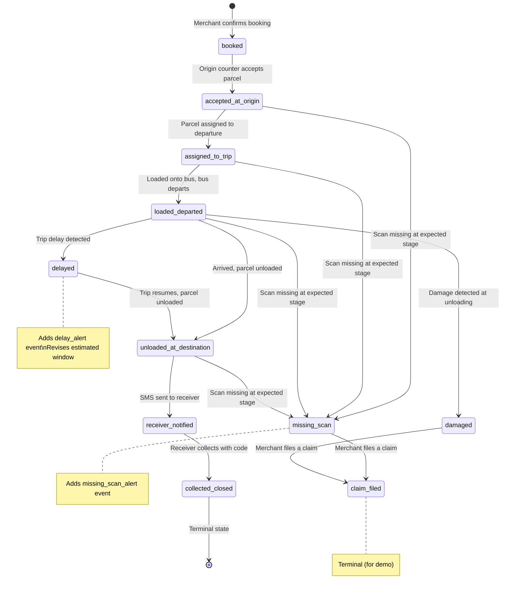

# BusBondhu Express — Demo Prototype Build Plan

> **Status**: COMPLETED — All Phases 1 through 5 fully implemented, verified, and ready for investor pitch.
> **Target**: Ideathon Bangladesh 2026 investor pitch demo.
> **Stack**: Next.js 16.4 (App Router) · TypeScript strict · Tailwind CSS v4 · Zustand · shadcn/ui

---

## 1. Assumptions & Open Questions

| # | Question | Proposed Default | Impact |
|---|----------|-----------------|--------|
| 1 | **Bangla font weight**: Ship all weights of Noto Sans Bengali or just Regular+SemiBold? Full family is ~1.2 MB. | **Regular (400) + SemiBold (600) only** — keeps bundle small; add more in production. | Page load speed |
| 2 | **shadcn/ui theme**: Use their "New York" or "Default" style? | **"New York"** — more refined, fits the professional logistics look. | Visual tone of every component |
| 3 | **Number of seed departures**: Brief says 6–8. Should they all be on the Dhaka→Cumilla corridor, or include 1–2 "coming soon" corridors? | **6 departures Dhaka→Cumilla + 2 greyed-out stubs for Dhaka→Chattogram and Dhaka→Sylhet** to show extensibility. | Seed data volume |
| 4 | **Investor lens (Phase 5)**: Full annotation system or a simpler tooltip approach? Building a full annotation rail is ~1 day extra. | **Tooltip approach** — small info icons beside key steps, toggled globally. Simpler to build, still communicates the concept. | Phase 5 scope |
| 5 | **PWA manifest icon**: Generate a real app icon or use a placeholder? | **Generate a simple branded icon** using the image-generation tool during Phase 1 (BusBondhu "BB" mark in brand colors). | Polish / installability |

> **To approve defaults**: reply "go with defaults" or specify overrides per number.

---

## 2. Information Architecture

### 2.1 Route Map

```
/                                → Landing page (pitch + "Open live demo")
/login                           → Mock phone-OTP login
/home                            → Merchant home (active shipments, quick book, history)
/book                            → Booking wizard (5-step)
/book/confirm                    → Confirmation screen (QR label, share links)
/shipment/[id]                   → Shipment detail (timeline, evidence drawer)
/track/[token]                   → Receiver tracking page (public, no login)
/claim/[shipmentId]              → Report issue / claim flow
/notifications                   → Notifications centre (simulated SMS/alerts)
```

**Non-page routes:**
- `(auth)` route group wraps `/login` (no app shell)
- `(app)` route group wraps `/home`, `/book`, `/book/confirm`, `/shipment/[id]`, `/claim/[shipmentId]`, `/notifications` (shared app shell with nav + demo banner)
- `(public)` route group wraps `/track/[token]` (standalone receiver layout)
- `/` landing is at the root, with its own minimal layout

### 2.2 Screen List

| Screen | Auth? | Layout | Mobile-first Notes |
|--------|-------|--------|-------------------|
| Landing | No | Minimal (no nav bar) | Single-scroll, CTA above fold |
| Login | No | Centred card | Phone input + OTP pad, large tap targets |
| Merchant Home | Yes | App shell (bottom tab nav) | Card list, FAB for "Book a parcel" |
| Booking Wizard | Yes | App shell + step indicator | Full-width steps, sticky bottom CTA bar |
| Confirmation | Yes | App shell | QR centre-stage, share buttons below |
| Shipment Detail | Yes | App shell | Vertical timeline, expandable evidence cards |
| Receiver Track | No | Standalone branded | Compact timeline, collection code reveal |
| Claim Flow | Yes | App shell | Multi-step form (type → details → submitted) |
| Notifications | Yes | App shell | Chronological list, status pills |

### 2.3 User Flows

#### Happy Path (Merchant)
```
Landing → Login → Home → Book a Parcel
  → Step 1: Route & Date
  → Step 2: Parcel Details
  → Step 3: Choose Departure
  → Step 4: Receiver & Payment
  → Step 5: Review & Confirm
  → Confirmation (QR + tracking link)
  → Home (shipment appears in active list)
  → [Demo Control Panel advances stages]
  → Shipment Detail (timeline fills in)
  → Notifications (SMS previews arrive)
```

#### Happy Path (Receiver)
```
Receives SMS link → /track/[token]
  → Sees masked info, timeline, estimated window
  → Status changes to "Ready for collection"
  → Collection code revealed
  → Picks up parcel
```

#### Exception Path (Delayed Trip)
```
[Same as happy path through booking]
  → Demo Panel: "Delayed trip" preset
  → Shipment detail: delay alert, revised window
  → Receiver page: updated window, delay notice
  → Notification: delay SMS preview
  → Demo Panel: resumes stages → eventual collection
```

#### Exception Path (Missing Scan → Claim)
```
[Same as happy path through "Loaded & departed"]
  → Demo Panel: "Missing-scan exception" preset
  → Shipment detail: missing-scan alert, exception status
  → Merchant navigates to "Report an issue"
  → Claim flow: selects "Missing", adds description
  → Claim reference generated
  → Notifications: claim acknowledgement
```

---

## 3. Folder & File Structure

```
Bus-Bondhu/
├── public/
│   ├── manifest.json
│   └── icons/                      # PWA icons (generated)
├── src/
│   ├── app/
│   │   ├── layout.tsx              # Root layout (html, body, fonts, providers)
│   │   ├── page.tsx                # Landing page
│   │   ├── globals.css             # Tailwind directives + design tokens
│   │   │
│   │   ├── (auth)/
│   │   │   └── login/
│   │   │       └── page.tsx
│   │   │
│   │   ├── (app)/
│   │   │   ├── layout.tsx          # App shell (nav, demo banner, demo panel)
│   │   │   ├── home/
│   │   │   │   └── page.tsx
│   │   │   ├── book/
│   │   │   │   ├── page.tsx        # Booking wizard
│   │   │   │   └── confirm/
│   │   │   │       └── page.tsx    # Confirmation + QR
│   │   │   ├── shipment/
│   │   │   │   └── [id]/
│   │   │   │       └── page.tsx    # Shipment detail + timeline
│   │   │   ├── claim/
│   │   │   │   └── [shipmentId]/
│   │   │   │       └── page.tsx    # Report issue / claim
│   │   │   └── notifications/
│   │   │       └── page.tsx
│   │   │
│   │   └── (public)/
│   │       ├── layout.tsx          # Standalone receiver layout
│   │       └── track/
│   │           └── [token]/
│   │               └── page.tsx    # Receiver tracking page
│   │
│   ├── components/
│   │   ├── ui/                     # shadcn/ui primitives (Button, Card, Input…)
│   │   ├── shared/                 # App-wide shared components
│   │   │   ├── AppShell.tsx        # Bottom nav + header
│   │   │   ├── DemoBanner.tsx      # "Prototype demo" persistent banner
│   │   │   ├── LanguageToggle.tsx
│   │   │   ├── SmsPreviewToast.tsx
│   │   │   ├── StatusChip.tsx
│   │   │   ├── PriceDisplay.tsx    # Shows price with "indicative" label
│   │   │   ├── TimeWindow.tsx      # Estimated arrival window display
│   │   │   └── LoadingSpinner.tsx
│   │   ├── landing/
│   │   │   ├── HeroSection.tsx
│   │   │   └── JourneySteps.tsx    # 7-step visual
│   │   ├── booking/
│   │   │   ├── BookingWizard.tsx   # Step orchestrator
│   │   │   ├── StepIndicator.tsx
│   │   │   ├── RouteAndDate.tsx    # Step 1
│   │   │   ├── ParcelDetails.tsx   # Step 2
│   │   │   ├── DepartureSelect.tsx # Step 3
│   │   │   ├── ReceiverPayment.tsx # Step 4
│   │   │   ├── ReviewConfirm.tsx   # Step 5
│   │   │   ├── VolumeGuide.tsx
│   │   │   └── RestrictedItems.tsx
│   │   ├── shipment/
│   │   │   ├── ShipmentCard.tsx    # For home list
│   │   │   ├── Timeline.tsx        # 7-stage vertical timeline
│   │   │   ├── TimelineEvent.tsx   # Single event row
│   │   │   ├── EvidenceDrawer.tsx
│   │   │   └── CountdownTimer.tsx  # Cutoff countdown
│   │   ├── tracking/
│   │   │   ├── ReceiverTimeline.tsx
│   │   │   ├── CollectionCode.tsx  # Revealed on "Ready" status
│   │   │   └── CounterInfo.tsx     # Counter name/hours/map placeholder
│   │   ├── claim/
│   │   │   ├── ClaimForm.tsx
│   │   │   ├── ClaimTypeSelect.tsx
│   │   │   └── PolicySummary.tsx
│   │   ├── notifications/
│   │   │   └── NotificationList.tsx
│   │   └── demo-panel/
│   │       ├── DemoControlPanel.tsx   # Main floating panel
│   │       ├── StageAdvancer.tsx      # Advance one stage button
│   │       ├── AutoPlayControls.tsx   # Auto-play toggle + speed
│   │       ├── ScenarioPresets.tsx    # Happy/Delayed/Missing presets
│   │       ├── SmsPreviewModal.tsx    # Phone mock for SMS
│   │       └── DataControls.tsx       # Reset / Load seed
│   │
│   ├── lib/
│   │   ├── store/                  # Zustand stores
│   │   │   ├── auth-store.ts
│   │   │   ├── shipment-store.ts   # Core shipment state
│   │   │   ├── demo-store.ts       # Demo panel state + auto-play
│   │   │   └── notification-store.ts
│   │   ├── api/                    # Service layer (mock async)
│   │   │   ├── auth.ts
│   │   │   ├── shipments.ts
│   │   │   ├── departures.ts
│   │   │   ├── claims.ts
│   │   │   └── notifications.ts
│   │   ├── data/                   # Seed data + constants
│   │   │   ├── seed.ts             # All seed merchants, shipments, departures
│   │   │   ├── routes.ts           # Corridor definitions
│   │   │   └── constants.ts        # Status enums, price bands, etc.
│   │   ├── types/                  # TypeScript type definitions
│   │   │   └── index.ts
│   │   ├── i18n/                   # Internationalisation
│   │   │   ├── dictionaries.ts     # Loader
│   │   │   ├── en.json
│   │   │   └── bn.json
│   │   ├── utils/
│   │   │   ├── format.ts           # Date, currency, phone formatters
│   │   │   ├── qr.ts               # QR data builder
│   │   │   └── sms-templates.ts    # SMS message templates
│   │   └── hooks/
│   │       ├── use-demo-hotkey.ts   # "D" key toggle
│   │       └── use-countdown.ts     # Cutoff countdown logic
│   │
│   └── styles/
│       └── tokens.css              # Design token definitions (imported in globals.css)
│
├── next.config.ts
├── tailwind.config.ts              # (only if Tailwind v4 needs one; v4 uses CSS config)
├── tsconfig.json
├── package.json
├── PLAN.md                         # This file
└── README.md
```

---

## 4. Component Inventory

### 4.1 Shared UI (from shadcn/ui + custom)

| Component | Source | Purpose |
|-----------|--------|---------|
| `Button` | shadcn | Primary, secondary, ghost, destructive variants |
| `Card`, `CardContent`, `CardHeader` | shadcn | Container for shipment cards, form sections |
| `Input`, `Textarea` | shadcn | Form fields |
| `Select` | shadcn | Dropdowns (size band, content category, payment) |
| `Dialog` / `Sheet` | shadcn | Evidence drawer, SMS preview modal |
| `Badge` | shadcn | Status chips, "coming soon" tags |
| `Tabs` | shadcn | Home screen tabs (Active / History) |
| `Toast` / `Sonner` | shadcn | SMS preview toasts, success/error feedback |
| `Accordion` | shadcn | Restricted items checklist, policy summary |
| `Checkbox` | shadcn | Restricted items acknowledgement |
| `RadioGroup` | shadcn | Claim type, payment method, size band |
| `Separator` | shadcn | Visual dividers |
| `Skeleton` | shadcn | Loading states |
| `StatusChip` | Custom | Coloured pill for shipment status |
| `PriceDisplay` | Custom | Price + "indicative" label |
| `TimeWindow` | Custom | "Estimated 2:00 PM – 3:30 PM" with clock icon |
| `DemoBanner` | Custom | Persistent "Prototype demo…" footer |
| `SmsPreviewToast` | Custom | Phone-shaped SMS mock toast |
| `LanguageToggle` | Custom | EN/বাং switch |
| `LoadingSpinner` | Custom | Branded spinner with BB mark |

### 4.2 Feature Components

| Component | Screen | Responsibility |
|-----------|--------|----------------|
| `HeroSection` | Landing | Headline, sub-copy, CTA |
| `JourneySteps` | Landing | 7-step horizontal/vertical journey visual |
| `BookingWizard` | Book | Multi-step orchestrator with validation |
| `StepIndicator` | Book | Progress dots/bar |
| `RouteAndDate` | Book Step 1 | Route selector, date picker |
| `ParcelDetails` | Book Step 2 | Size band, contents, declared value, restricted items |
| `DepartureSelect` | Book Step 3 | Departure list with capacity/cutoff |
| `ReceiverPayment` | Book Step 4 | Receiver info, payment mode |
| `ReviewConfirm` | Book Step 5 | Full summary, price breakdown |
| `ShipmentCard` | Home | Compact shipment summary card |
| `Timeline` | Shipment Detail | 7-stage vertical timeline |
| `TimelineEvent` | Shipment Detail | Single stage row with timestamp/actor |
| `EvidenceDrawer` | Shipment Detail | Slide-out showing condition notes |
| `CountdownTimer` | Shipment Detail | Live countdown to cutoff |
| `ReceiverTimeline` | Track | Simplified timeline for receiver |
| `CollectionCode` | Track | Reveals 6-digit code at "Ready" status |
| `CounterInfo` | Track | Counter address/hours, map placeholder |
| `ClaimForm` | Claim | Multi-step issue report |
| `ClaimTypeSelect` | Claim | Issue type grid |
| `PolicySummary` | Claim | Compensation policy disclosure |
| `NotificationList` | Notifications | Chronological list of simulated alerts |

### 4.3 Demo Panel Components

| Component | Responsibility |
|-----------|----------------|
| `DemoControlPanel` | Floating container, collapse/expand, hotkey listener |
| `StageAdvancer` | Shipment selector + "Advance" button |
| `AutoPlayControls` | Toggle auto-play, speed slider (1s–10s) |
| `ScenarioPresets` | Buttons for Happy / Delayed / Missing-scan presets |
| `SmsPreviewModal` | Phone mock-up showing SMS text |
| `DataControls` | "Reset demo data" and "Load seeded data" buttons |

---

## 5. Data Model, State Machine & Service Layer

### 5.1 TypeScript Types

```typescript
// ---- Core Entities ----

type UserId = string;       // e.g. "user_01"
type ShipmentId = string;   // e.g. "SHP-240101-001"
type DepartureId = string;  // e.g. "DEP-DhkCml-001"
type ClaimId = string;      // e.g. "CLM-001"
type TrackingToken = string; // e.g. "trk_abc123" (URL-safe)

interface User {
  id: UserId;
  phone: string;            // 01XXXXXXXXX format
  name: string;
  role: 'merchant';
}

interface Merchant extends User {
  businessName: string;
  savedReceivers: SavedReceiver[];
}

interface SavedReceiver {
  id: string;
  name: string;
  phone: string;
  usageCount: number;
}

interface Route {
  id: string;
  origin: string;           // "Dhaka"
  destination: string;      // "Cumilla"
  originCounter: Counter;
  destinationCounter: Counter;
  isActive: boolean;        // false = "coming soon"
}

interface Counter {
  id: string;
  name: string;             // "Demo Counter – Dhaka (Gulistan)"
  address: string;
  hours: string;            // "8:00 AM – 9:00 PM"
  operatorName: string;     // "Demo Operator A"
}

interface Departure {
  id: DepartureId;
  routeId: string;
  date: string;             // ISO date
  departureTime: string;    // "10:30 AM"
  cutoffTime: string;       // "10:00 AM" (30 min before)
  estimatedArrivalWindow: {
    earliest: string;       // ISO datetime
    latest: string;         // ISO datetime
  };
  operatorName: string;
  busIdentifier: string;    // "Demo Bus DK-201"
  capacityConfirmed: boolean;
  originCounter: Counter;
  destinationCounter: Counter;
}

type SizeBand = 'standard' | 'medium' | 'bulky';
type ContentsCategory = 'clothing_textile' | 'general';
type PaymentMode = 'pay_at_origin' | 'receiver_pays';
type PaymentMethod = 'bkash' | 'nagad' | 'cash';

interface Parcel {
  sizeBand: SizeBand;
  contentsCategory: ContentsCategory;
  declaredValue: number;      // Tk, max 5000
  description: string;
  restrictedItemsAcknowledged: boolean;
}

interface PriceBreakdown {
  routeFee: number;           // by band: 100 / 130 / 160
  total: number;              // same as routeFee for pilot (no extras)
  currency: 'BDT';
  label: 'indicative';
}

type ShipmentStatus =
  | 'booked'
  | 'accepted_at_origin'
  | 'assigned_to_trip'
  | 'loaded_departed'
  | 'unloaded_at_destination'
  | 'receiver_notified'
  | 'collected_closed'
  // Exception statuses
  | 'delayed'
  | 'missing_scan'
  | 'damaged'
  | 'claim_filed';

interface Shipment {
  id: ShipmentId;
  trackingToken: TrackingToken;
  merchantId: UserId;
  parcel: Parcel;
  price: PriceBreakdown;
  paymentMode: PaymentMode;
  paymentMethod: PaymentMethod;
  receiver: {
    name: string;
    phone: string;
  };
  route: Route;
  departureId: DepartureId;
  status: ShipmentStatus;
  collectionCode: string;    // 6-digit, revealed only at "receiver_notified"
  events: HandoverEvent[];
  createdAt: string;         // ISO datetime
  claim?: Claim;
}

type EventType =
  | 'booked'
  | 'accepted_at_origin'
  | 'assigned_to_trip'
  | 'loaded_departed'
  | 'unloaded_at_destination'
  | 'receiver_notified'
  | 'collected_closed'
  | 'delay_alert'
  | 'missing_scan_alert'
  | 'damaged_alert';

type ActorRole = 'system' | 'origin_counter' | 'bus_operator' | 'destination_counter';

interface HandoverEvent {
  id: string;
  type: EventType;
  timestamp: string;         // ISO datetime
  actor: {
    role: ActorRole;
    name: string;            // "Demo Operator A"
  };
  location: string;          // "Demo Counter – Dhaka (Gulistan)"
  note: string;              // "Parcel received and labelled"
  condition?: string;        // "Good condition" / "Minor dent noted"
}

type ClaimType = 'delay' | 'damaged' | 'missing' | 'wrong_handover';
type ClaimStatus = 'submitted' | 'under_review' | 'resolved';

interface Claim {
  id: ClaimId;
  shipmentId: ShipmentId;
  type: ClaimType;
  description: string;
  photoUrl?: string;         // Simulated (data URI or placeholder)
  status: ClaimStatus;
  createdAt: string;
  reference: string;         // "CLM-20241001-001"
  policyNote: string;        // "Pilot policy: compensation capped at Tk 2,000…"
}

interface Notification {
  id: string;
  shipmentId: ShipmentId;
  type: 'sms_booking_confirmed' | 'sms_ready_to_collect' | 'sms_delay_alert'
       | 'claim_acknowledged' | 'status_update';
  title: string;
  message: string;           // Full SMS text
  timestamp: string;
  read: boolean;
  recipientPhone: string;
  recipientRole: 'merchant' | 'receiver';
}
```

### 5.2 Shipment Status State Machine



**Allowed transitions (explicit):**

| From | To | Trigger |
|------|----|---------|
| `booked` | `accepted_at_origin` | Origin counter accepts |
| `accepted_at_origin` | `assigned_to_trip` | Assigned to departure |
| `assigned_to_trip` | `loaded_departed` | Bus loads and departs |
| `loaded_departed` | `unloaded_at_destination` | Arrived at destination |
| `loaded_departed` | `delayed` | Delay detected |
| `delayed` | `unloaded_at_destination` | Delay resolved, arrived |
| `unloaded_at_destination` | `receiver_notified` | SMS sent |
| `receiver_notified` | `collected_closed` | Receiver collects |
| Any non-terminal | `missing_scan` | Missing scan exception |
| `loaded_departed` | `damaged` | Damage detected |
| `missing_scan` / `damaged` | `claim_filed` | Merchant files claim |

**Terminal states**: `collected_closed`, `claim_filed`

### 5.3 Service Layer API Contract

Every function returns a `Promise` with artificial latency (200–600ms, randomised) to simulate network calls. The store is the source of truth; the service layer reads/writes to Zustand.

```typescript
// src/lib/api/auth.ts
requestOtp(phone: string): Promise<{ success: boolean; demoCode: string }>
verifyOtp(phone: string, code: string): Promise<{ user: Merchant }>
logout(): Promise<void>

// src/lib/api/shipments.ts
getActiveShipments(merchantId: string): Promise<Shipment[]>
getShipmentHistory(merchantId: string): Promise<Shipment[]>
getShipmentById(id: ShipmentId): Promise<Shipment | null>
getShipmentByToken(token: TrackingToken): Promise<Shipment | null>
createShipment(data: CreateShipmentInput): Promise<Shipment>

// src/lib/api/departures.ts
getAvailableDepartures(routeId: string, date: string): Promise<Departure[]>

// src/lib/api/claims.ts
fileClaim(data: FileClaimInput): Promise<Claim>
getClaimByShipmentId(shipmentId: ShipmentId): Promise<Claim | null>

// src/lib/api/notifications.ts
getNotifications(merchantId: string): Promise<Notification[]>
markAsRead(notificationId: string): Promise<void>

// src/lib/api/demo.ts  (used by Demo Control Panel)
advanceShipmentStage(shipmentId: ShipmentId): Promise<HandoverEvent>
triggerDelayScenario(shipmentId: ShipmentId): Promise<void>
triggerMissingScanScenario(shipmentId: ShipmentId): Promise<void>
resetAllData(): Promise<void>
loadSeedData(): Promise<void>
```

---

## 6. Demo Control Panel Design

### 6.1 Visual Design
- **Position**: Fixed bottom-right, floating above content
- **Collapsed state**: Small pill button reading "🎮 Demo" (also toggled with `D` hotkey)
- **Expanded state**: 320px-wide card with sections, semi-transparent backdrop, scrollable
- **Z-index**: Above everything except modals
- **Styling**: Distinct from main UI (dark background, monospace labels) so it's obviously not part of the customer app

### 6.2 Sections & Controls

#### Section A: Shipment Selector
- Dropdown of all shipments (by ID + short description)
- Current status shown as a chip

#### Section B: Stage Advancer
- "▶ Advance to next stage" button (disabled at terminal states)
- Shows what the next stage will be
- Each click:
  1. Determines next valid status from the state machine
  2. Creates a `HandoverEvent` with timestamp, actor, location, note
  3. Updates shipment status
  4. Triggers appropriate notification (SMS preview toast)

#### Section C: Auto-Play
- Toggle switch: "Auto-play"
- Speed slider: 1s – 10s per stage (default 3s)
- When active, advances the selected shipment one stage every N seconds
- Stops at terminal states
- Visual: pulsing indicator when running

#### Section D: Scenario Presets
- **🟢 Happy path**: Resets selected shipment to `booked`, then auto-plays through all 6 stages
- **🟡 Delayed trip**: Advances to `loaded_departed`, injects a `delayed` status with revised window, pauses, then resumes to collection
- **🔴 Missing scan**: Advances to `assigned_to_trip`, injects `missing_scan` alert, triggers claim flow availability

#### Section E: SMS Preview
- Whenever a notification of type `sms_*` is created, display a toast styled as a phone notification
- Toast shows: recipient phone (masked), message text, timestamp
- Toast auto-dismisses after 5s but can be clicked to expand to a phone mock-up modal

#### Section F: Data Controls
- **"Reset demo data"**: Clears all localStorage, resets stores to empty
- **"Load seeded data"**: Populates stores with full seed data (see §7)

### 6.3 Events Emitted (via Zustand actions)

| Panel Action | Store Mutation | Side Effect |
|-------------|---------------|-------------|
| Advance stage | `shipmentStore.advanceStage(id)` | Appends event, updates status, may trigger notification |
| Trigger delay | `shipmentStore.triggerDelay(id)` | Sets status to `delayed`, appends delay event, revises window, creates delay notification |
| Trigger missing | `shipmentStore.triggerMissingScan(id)` | Sets status to `missing_scan`, appends alert event |
| Reset data | `shipmentStore.reset()` + `notificationStore.reset()` + `authStore.reset()` | Clears localStorage |
| Load seed | `shipmentStore.loadSeed()` + `notificationStore.loadSeed()` | Populates from `seed.ts` |
| Auto-play tick | `shipmentStore.advanceStage(id)` | Same as manual advance |

---

## 7. Seed Data Spec

### 7.1 Fictional Operators & Counters

| Entity | Name | Details |
|--------|------|---------|
| Operator 1 | Demo Operator Shohoj | Fictional bus operator |
| Operator 2 | Demo Operator Greenline | Fictional bus operator |
| Counter – Dhaka | Demo Counter – Dhaka (Gulistan) | Address: "Gulistan Bus Terminal (demo)", Hours: 7:00 AM – 10:00 PM |
| Counter – Dhaka Alt | Demo Counter – Dhaka (Sayedabad) | Address: "Sayedabad Bus Terminal (demo)", Hours: 6:30 AM – 10:00 PM |
| Counter – Cumilla | Demo Counter – Cumilla (Kandirpar) | Address: "Kandirpar Bus Stand (demo)", Hours: 7:00 AM – 9:00 PM |

### 7.2 Merchants (3)

| Merchant | Business | Phone | Saved Receivers |
|----------|----------|-------|-----------------|
| Rahim Uddin | "Rahim Textiles" | 01712345678 | Kamal Hasan (01812345678), Fatema Akter (01912345678) |
| Sultana Begum | "Sultana Fashion House" | 01787654321 | Noor Islam (01887654321) |
| Arif Hossain | "Arif Online Store" | 01611223344 | Jamal Mia (01511223344), Rashida Khatun (01411223344) |

### 7.3 Departures (8)

| ID | Route | Date | Time | Cutoff | Est. Arrival Window | Operator | Bus | Capacity |
|----|-------|------|------|--------|---------------------|----------|-----|----------|
| DEP-001 | Dhaka→Cumilla | Today | 8:00 AM | 7:30 AM | 11:00 AM – 12:30 PM | Shohoj | DK-201 | ✅ |
| DEP-002 | Dhaka→Cumilla | Today | 10:30 AM | 10:00 AM | 1:30 PM – 3:00 PM | Greenline | DK-305 | ✅ |
| DEP-003 | Dhaka→Cumilla | Today | 1:00 PM | 12:30 PM | 4:00 PM – 5:30 PM | Shohoj | DK-202 | ✅ |
| DEP-004 | Dhaka→Cumilla | Today | 3:30 PM | 3:00 PM | 6:30 PM – 8:00 PM | Greenline | DK-306 | ✅ |
| DEP-005 | Dhaka→Cumilla | Tomorrow | 8:00 AM | 7:30 AM | 11:00 AM – 12:30 PM | Shohoj | DK-201 | ✅ |
| DEP-006 | Dhaka→Cumilla | Tomorrow | 2:00 PM | 1:30 PM | 5:00 PM – 6:30 PM | Greenline | DK-305 | ✅ |
| DEP-007 | Dhaka→Chattogram | Today | 9:00 AM | — | — | — | — | 🔒 Coming soon |
| DEP-008 | Dhaka→Sylhet | Today | 7:00 AM | — | — | — | — | 🔒 Coming soon |

### 7.4 Shipments (across all statuses, for seeded demo)

| ID | Merchant | Receiver | Band | Status | Notes |
|----|----------|----------|------|--------|-------|
| SHP-001 | Rahim Uddin | Kamal Hasan | Standard (Tk 100) | `collected_closed` | Full happy path completed |
| SHP-002 | Rahim Uddin | Fatema Akter | Medium (Tk 130) | `loaded_departed` | In transit |
| SHP-003 | Sultana Begum | Noor Islam | Bulky (Tk 160) | `booked` | Fresh booking, for demo advancement |
| SHP-004 | Sultana Begum | Noor Islam | Standard (Tk 100) | `receiver_notified` | Ready for collection |
| SHP-005 | Arif Hossain | Jamal Mia | Medium (Tk 130) | `delayed` | Trip delayed scenario |
| SHP-006 | Arif Hossain | Rashida Khatun | Standard (Tk 100) | `claim_filed` | Missing-scan claim filed |
| SHP-007 | Rahim Uddin | Kamal Hasan | Standard (Tk 100) | `accepted_at_origin` | Early stage for demo |

---

## 8. Design System Tokens & Key Screen Wireframes

### 8.1 Design Tokens

```css
/* --- Color Palette --- */
--color-primary:        hsl(215, 75%, 45%);    /* Deep blue — trust, logistics */
--color-primary-light:  hsl(215, 75%, 55%);
--color-primary-dark:   hsl(215, 75%, 35%);
--color-secondary:      hsl(160, 55%, 42%);    /* Teal-green — success, confirmed */
--color-accent:         hsl(35, 90%, 55%);     /* Warm amber — attention, CTAs */

--color-bg:             hsl(220, 15%, 97%);    /* Near-white */
--color-surface:        hsl(0, 0%, 100%);      /* Card background */
--color-surface-raised: hsl(220, 15%, 95%);    /* Slightly elevated */

--color-text-primary:   hsl(220, 20%, 15%);    /* Near-black */
--color-text-secondary: hsl(220, 10%, 45%);    /* Muted */
--color-text-inverse:   hsl(0, 0%, 100%);

--color-border:         hsl(220, 15%, 88%);
--color-border-focus:   var(--color-primary);

/* Status colors */
--color-status-booked:       hsl(215, 60%, 55%);
--color-status-in-progress:  hsl(35, 80%, 50%);
--color-status-completed:    hsl(160, 55%, 42%);
--color-status-exception:    hsl(0, 70%, 55%);
--color-status-delayed:      hsl(25, 85%, 55%);

/* Demo panel (visually distinct) */
--color-demo-bg:        hsl(260, 30%, 18%);
--color-demo-text:      hsl(0, 0%, 90%);
--color-demo-accent:    hsl(280, 60%, 65%);

/* --- Typography --- */
--font-sans:     'Inter', 'Noto Sans Bengali', system-ui, sans-serif;
--font-mono:     'JetBrains Mono', monospace;

--text-xs:   0.75rem;   /* 12px */
--text-sm:   0.875rem;  /* 14px */
--text-base: 1rem;      /* 16px */
--text-lg:   1.125rem;  /* 18px */
--text-xl:   1.25rem;   /* 20px */
--text-2xl:  1.5rem;    /* 24px */
--text-3xl:  1.875rem;  /* 30px */

/* --- Spacing --- */
--space-1: 0.25rem;  /* 4px */
--space-2: 0.5rem;   /* 8px */
--space-3: 0.75rem;  /* 12px */
--space-4: 1rem;     /* 16px */
--space-5: 1.25rem;  /* 20px */
--space-6: 1.5rem;   /* 24px */
--space-8: 2rem;     /* 32px */
--space-10: 2.5rem;  /* 40px */
--space-12: 3rem;    /* 48px */

/* --- Radius --- */
--radius-sm:   0.375rem;  /* 6px */
--radius-md:   0.5rem;    /* 8px */
--radius-lg:   0.75rem;   /* 12px */
--radius-xl:   1rem;      /* 16px */
--radius-full: 9999px;    /* Pill */

/* --- Shadows --- */
--shadow-sm:  0 1px 2px hsla(220, 20%, 15%, 0.06);
--shadow-md:  0 4px 12px hsla(220, 20%, 15%, 0.08);
--shadow-lg:  0 8px 24px hsla(220, 20%, 15%, 0.12);

/* --- Transitions --- */
--transition-fast: 150ms ease;
--transition-base: 250ms ease;
--transition-slow: 400ms ease;
```

### 8.2 Key Screen Wireframes (text descriptions, mobile at 375px)

#### Landing Page
```
┌─────────────────────────────┐
│  BusBondhu Express logo     │
│                             │
│  "Trusted parcel dispatch   │
│   on intercity buses"       │
│                             │
│  ┌───────────────────────┐  │
│  │ 7-step journey visual │  │
│  │ (horizontal scroll    │  │
│  │  or vertical stack)   │  │
│  │ Book → Accept → Load  │  │
│  │ → Travel → Unload     │  │
│  │ → Notify → Collect    │  │
│  └───────────────────────┘  │
│                             │
│  ┌───────────────────────┐  │
│  │  🚀 Open Live Demo    │  │
│  └───────────────────────┘  │
│                             │
│  ─── Demo banner ────────── │
└─────────────────────────────┘
```

#### Merchant Home
```
┌─────────────────────────────┐
│  Header: "BusBondhu" + 🔔 + │
│          🌐 Lang toggle      │
├─────────────────────────────┤
│  "Hello, Rahim"             │
│                             │
│  ┌───────────────────────┐  │
│  │  + Book a Parcel      │  │
│  │  (large tappable card)│  │
│  └───────────────────────┘  │
│                             │
│  [Active] [History]  (tabs) │
│                             │
│  ┌───────────────────────┐  │
│  │ SHP-003 · Booked      │  │
│  │ Dhaka → Cumilla       │  │
│  │ Standard · Tk 100     │  │
│  │ To: Kamal Hasan       │  │
│  └───────────────────────┘  │
│  ┌───────────────────────┐  │
│  │ SHP-002 · In Transit  │  │
│  │ Dhaka → Cumilla       │  │
│  │ Medium · Tk 130       │  │
│  └───────────────────────┘  │
│                             │
│  ─── Demo banner ────────── │
├─────────────────────────────┤
│ 🏠 Home │ 📦 Book │ 🔔 Notif│
└─────────────────────────────┘
```

#### Booking Wizard (Step 3 shown: Choose Departure)
```
┌─────────────────────────────┐
│  ← Back    Step 3 of 5      │
│  ●●●○○  (progress dots)     │
├─────────────────────────────┤
│  "Choose a Departure"       │
│                             │
│  ┌───────────────────────┐  │
│  │ 🟢 10:30 AM departure │  │
│  │ Demo Operator Greenline│  │
│  │ Bus DK-305             │  │
│  │ Cutoff: 10:00 AM       │  │
│  │ Est: 1:30–3:00 PM      │  │
│  │ ✅ Capacity confirmed  │  │
│  │ Origin: Gulistan       │  │
│  │ Dest: Kandirpar        │  │
│  │           [Select]     │  │
│  └───────────────────────┘  │
│  ┌───────────────────────┐  │
│  │ 🔴 8:00 AM (past cut) │  │
│  │ (disabled, greyed out)│  │
│  └───────────────────────┘  │
│                             │
├─────────────────────────────┤
│      [Continue →]           │
└─────────────────────────────┘
```

#### Shipment Detail (Timeline)
```
┌─────────────────────────────┐
│  ← Back    SHP-003          │
├─────────────────────────────┤
│  Status: In Transit 🟡      │
│  Est arrival: 1:30–3:00 PM  │
│  Cutoff was: ✅ (met)       │
│                             │
│  ── Timeline ──             │
│  ● Booked           10:05  │
│  │ System · Auto             │
│  ● Accepted         10:15  │
│  │ Origin Counter · Gulistan │
│  ● Assigned         10:20  │
│  │ Origin Counter · DK-305   │
│  ◉ Loaded & Departed 10:32 │
│  │ Bus Op · Greenline        │
│  ○ Unloaded         ──:──  │
│  ○ Receiver Notified ──:── │
│  ○ Collected         ──:── │
│                             │
│  [📋 Copy tracking link]   │
│  [📱 Share on WhatsApp]    │
│                             │
│  ─── Demo banner ────────── │
└─────────────────────────────┘
```

#### Receiver Page (/track/[token])
```
┌─────────────────────────────┐
│  BusBondhu Express          │
│  Track Your Parcel          │
├─────────────────────────────┤
│  From: R***n (01712...78)   │
│  To:   K***l (01812...78)   │
│  Status: Ready 🟢           │
│                             │
│  ── Timeline (compact) ──  │
│  ● Booked                   │
│  ● Accepted                 │
│  ● In Transit               │
│  ● Arrived                  │
│  ◉ Ready for Collection     │
│  ○ Collected                │
│                             │
│  ┌───────────────────────┐  │
│  │ Collection Code:      │  │
│  │     ██ 7 4 2 9 ██     │  │
│  │ Show this at counter  │  │
│  └───────────────────────┘  │
│                             │
│  📍 Demo Counter – Cumilla  │
│     Kandirpar Bus Stand     │
│     Hours: 7 AM – 9 PM     │
│     [Map placeholder]       │
│                             │
│  [⚠️ Report an issue]      │
│                             │
│  ─── Demo banner ────────── │
└─────────────────────────────┘
```

---

## 9. Dependency Plan

### Phase 1 – Foundation

| Package | Version | Reason |
|---------|---------|--------|
| `zustand` | ^5 | Client state management (fake backend) with persist middleware |
| `@radix-ui/react-*` | (via shadcn) | Accessible primitives for shadcn/ui components |
| `class-variance-authority` | ^0.7 | Variant-based component styling (shadcn dependency) |
| `clsx` | ^2 | Conditional class merging |
| `tailwind-merge` | ^3 | Deduplicate Tailwind classes |
| `lucide-react` | ^0.500 | Icon library |
| `date-fns` | ^4 | Date formatting, Asia/Dhaka timezone |
| `date-fns-tz` | ^3 | Timezone-aware formatting (may be included in date-fns v4) |

### Phase 2 – Booking

| Package | Version | Reason |
|---------|---------|--------|
| `react-hook-form` | ^7 | Form state management for booking wizard |
| `@hookform/resolvers` | ^5 | Zod integration for react-hook-form |
| `zod` | ^3 | Schema validation for forms |
| `qrcode.react` | ^4 | Client-side QR code generation |

### Phase 3 – Timeline & Demo Panel

| Package | Version | Reason |
|---------|---------|--------|
| `framer-motion` | ^12 | Timeline animations, panel transitions (respects prefers-reduced-motion) |
| `sonner` | ^2 | Toast notifications for SMS previews |

### Phase 4 – Claims

No additional dependencies. Uses existing form and UI libraries.

### Phase 5 – Polish

| Package | Version | Reason |
|---------|---------|--------|
| `@playwright/test` | ^1 (dev) | E2E smoke tests for demo flows |

> **i18n approach**: Simple dictionary-based approach (`src/lib/i18n/`) with a React context provider, rather than `next-intl`. Justification: We have a small number of screens, no server-side locale routing needed (it's a client-side demo), and a dictionary approach is zero-config, zero-dependency, and trivially replaceable. The context provider exposes a `t(key)` function and a `locale` state. Bangla JSON is loaded lazily.

---

## 10. Phased Build Plan

### Phase 1: Foundation
**Goal**: Scaffold, design system, layout shells, i18n skeleton, mock service layer, seed data

**Tasks**:
1. Configure Tailwind with design tokens (`tokens.css`, `globals.css`)
2. Set up fonts via `next/font` (Inter + Noto Sans Bengali)
3. Initialize shadcn/ui and install base components (Button, Card, Input, Badge, Skeleton, Separator)
4. Build root layout with DemoBanner
5. Build `(app)` layout with AppShell (header + bottom nav)
6. Build `(auth)` layout (centred card)
7. Build `(public)` layout (standalone branded)
8. Create all TypeScript types (`src/lib/types/index.ts`)
9. Create seed data (`src/lib/data/seed.ts`)
10. Create Zustand stores (auth, shipment, demo, notification) with persist middleware
11. Create service layer with artificial latency (`src/lib/api/*`)
12. Create i18n context, English dictionary, empty Bangla dictionary
13. Create landing page with HeroSection and JourneySteps
14. Generate PWA manifest and app icon
15. Add loading and error boundary files

**Acceptance Criteria**:
- [ ] `npm run dev` shows landing page with design system applied
- [ ] All route shells render (even if mostly empty) without errors
- [ ] Design tokens visible (correct colors, fonts, spacing)
- [ ] DemoBanner visible on all app pages
- [ ] Types compile with `tsc --noEmit`
- [ ] Seed data loads into store via DevTools/console
- [ ] i18n `t()` function returns English strings

### Phase 2: Login, Home & Booking
**Goal**: Complete the merchant booking journey from login through confirmation

**Tasks**:
1. Build mock OTP login (phone input → demo code display → OTP pad → store auth)
2. Build Merchant Home (active shipments, history tab, quick book card)
3. Build ShipmentCard component
4. Build BookingWizard with step orchestrator and StepIndicator
5. Build Step 1: RouteAndDate (route selector, date picker, "coming soon" routes disabled)
6. Build Step 2: ParcelDetails (size band selector, VolumeGuide, contents, declared value, RestrictedItems acknowledgement)
7. Build Step 3: DepartureSelect (departure list, cutoff logic, capacity badge)
8. Build Step 4: ReceiverPayment (receiver form, saved receivers, payment mode/method)
9. Build Step 5: ReviewConfirm (itemised price, final confirm)
10. Build Confirmation page (QR generation, booking ID, copy link, WhatsApp/Messenger share)
11. Form validation with zod schemas
12. Wire all steps to shipment store

**Acceptance Criteria**:
- [ ] Login with any phone + "123456" → merchant home
- [ ] Home shows seeded shipments with correct status chips
- [ ] Booking wizard validates each step (can't proceed without required fields)
- [ ] "Coming soon" routes are visible but not selectable
- [ ] Past-cutoff departures are disabled
- [ ] Price shown before confirmation matches size band
- [ ] QR code renders on confirmation page
- [ ] New shipment appears in home active list
- [ ] Tracking link is copyable and formatted correctly

### Phase 3: Timeline, Demo Panel & Receiver Page
**Goal**: Live timeline updates, working Demo Control Panel, receiver tracking

**Tasks**:
1. Build Timeline and TimelineEvent components with framer-motion animations
2. Build Shipment Detail page (timeline, status, evidence drawer, countdown)
3. Build EvidenceDrawer (sheet/drawer with condition notes per event)
4. Build DemoControlPanel (floating, collapsible, hotkey D)
5. Build StageAdvancer (advance one stage with event generation)
6. Build AutoPlayControls (toggle + speed slider)
7. Build ScenarioPresets (happy path, delayed, missing-scan buttons)
8. Build SmsPreviewToast and SmsPreviewModal
9. Build DataControls (reset + load seed)
10. Build Receiver page (`/track/[token]`) with ReceiverTimeline
11. Build CollectionCode (revealed at `receiver_notified`)
12. Build CounterInfo (counter details + map placeholder)
13. Wire SMS preview toasts to stage transitions
14. Implement auto-play interval logic

**Acceptance Criteria**:
- [ ] Timeline animates when stages advance
- [ ] Demo Panel toggles with D key and collapse button
- [ ] "Advance" button progresses one stage with timestamp + actor
- [ ] Auto-play walks through all stages at configured speed
- [ ] SMS preview toast appears at booking, ready-to-collect, and delay events
- [ ] Receiver page shows masked details
- [ ] Collection code is hidden until `receiver_notified`, then revealed
- [ ] "Happy path" preset runs full journey automatically
- [ ] Reset clears all data; Load seed restores it

### Phase 4: Exceptions & Claims
**Goal**: Exception scenarios work end-to-end; claim flow is complete

**Tasks**:
1. Implement delay scenario logic (revised window, delay event, delay notification)
2. Implement missing-scan scenario logic (alert event, exception status)
3. Build Claim page (`/claim/[shipmentId]`)
4. Build ClaimTypeSelect (delay, damaged, missing, wrong handover)
5. Build ClaimForm (description, simulated photo upload, policy summary)
6. Build PolicySummary component (compensation cap Tk 2,000, declared value cap Tk 5,000)
7. Wire "Delayed trip" preset in Demo Panel
8. Wire "Missing-scan" preset in Demo Panel → claim flow
9. Build Notifications page with NotificationList
10. Create notification entries for all event types

**Acceptance Criteria**:
- [ ] "Delayed trip" preset: delay event appears in timeline, receiver page shows updated window, delay SMS preview fires
- [ ] "Missing-scan" preset: exception alert in timeline, "Report an issue" CTA enabled
- [ ] Claim flow: select type → describe → submit → reference generated
- [ ] Policy summary text matches brief (capped at Tk 2,000 / Tk 5,000)
- [ ] Simulated photo upload works (file picker, preview thumbnail; no real upload)
- [ ] Notifications page lists all SMS/alert events chronologically
- [ ] All 3 demo presets work cleanly back-to-back with reset between

### Phase 5: Bangla, Investor Lens, Polish & Accessibility
**Goal**: Production-quality demo polish; Bangla toggle; optional investor annotations

**Tasks**:
1. Create Bangla translations for priority screens (Home, Booking Step 5, Confirmation, Shipment Detail, Receiver page)
2. Build LanguageToggle component and wire to i18n context
3. Build Investor Lens toggle (optional; global toggle, info tooltips)
4. Write investor annotations for key steps (who scans, evidence stored, operator earning)
5. Accessibility pass: keyboard navigation, focus management, ARIA labels, WCAG AA contrast audit
6. Add `prefers-reduced-motion` media query checks to all framer-motion animations
7. Responsive polish: test and fix layouts at 375px, 430px, 768px, 1024px, projector (1920px)
8. Add proper `<title>`, `<meta>` tags for every page
9. Write Playwright smoke tests (happy path, delay preset, claim flow)
10. Write README with setup, demo instructions, and architecture notes
11. Final Vercel deployment test

**Acceptance Criteria**:
- [ ] Bangla toggle switches UI strings on priority screens; unsupported screens fall back to English
- [ ] Investor lens toggle shows/hides annotations without affecting layout
- [ ] All interactive elements keyboard-accessible
- [ ] No contrast ratio below 4.5:1 (AA) for text
- [ ] Animations disabled when `prefers-reduced-motion: reduce`
- [ ] Playwright tests pass for happy path and exception path
- [ ] `npm run build` succeeds; deploys to Vercel without errors
- [ ] README documents setup, demo script, and architecture

---

## 11. Testing & Quality Plan

### Automated
| Layer | Tool | Coverage |
|-------|------|----------|
| Type checking | `tsc --noEmit` | All files, strict mode (already configured) |
| Linting | ESLint (already configured) | All `.ts`/`.tsx` files |
| E2E smoke | Playwright | 3 test suites (see below) |

### Playwright Test Suites

**Suite 1: Happy Path (3-minute demo)**
1. Navigate to landing → click "Open Live Demo"
2. Login with phone `01712345678`, OTP `123456`
3. Verify merchant home loads with shipments
4. Start booking wizard → complete all 5 steps
5. Verify confirmation page with QR
6. Open Demo Panel (press `D`)
7. Select the new shipment → advance through all 6 stages
8. Verify SMS previews appear
9. Open receiver tracking page via link
10. Verify collection code is revealed

**Suite 2: Delayed Trip**
1. Login → load seed data
2. Select SHP-003 in Demo Panel
3. Run "Delayed trip" preset
4. Verify delay alert in timeline
5. Verify revised arrival window
6. Verify delay notification in notifications page

**Suite 3: Missing Scan → Claim**
1. Login → load seed data
2. Select SHP-003 in Demo Panel
3. Run "Missing-scan" preset
4. Navigate to claim page
5. File a claim (type: missing, description)
6. Verify claim reference generated

### Manual Checklist (pre-pitch)
- [ ] Full 3-minute walkthrough on mobile Chrome (Android or iPhone)
- [ ] Full 90-second walkthrough on laptop (Chrome, projected)
- [ ] Demo Panel auto-play at 3s speed — no visual glitches
- [ ] All SMS previews readable
- [ ] QR code scans to correct tracking URL (any QR scanner app)
- [ ] Bangla toggle doesn't break layouts
- [ ] Reset + Load seed → clean slate, no stale data
- [ ] Browser back/forward navigation doesn't break state
- [ ] No console errors in production build

---

## 12. Demo Script

### 12.1 — 3-Minute Presenter Walkthrough

| Time | Action | What to say | Demo Control |
|------|--------|-------------|--------------|
| 0:00 | Open landing page | "BusBondhu Express — trusted parcel dispatch on intercity buses." | — |
| 0:10 | Point to 7-step journey visual | "Every parcel follows this chain of custody. Book, scan, load, travel, unload, notify, collect." | — |
| 0:20 | Tap "Open Live Demo" → Login | "Any merchant logs in with their phone. OTP is simulated." | — |
| 0:35 | On merchant home | "The merchant sees their active shipments. Let's book a new parcel." | — |
| 0:45 | Tap "Book a Parcel" → Step 1 | "Route: Dhaka to Cumilla. Other corridors coming soon." | — |
| 0:55 | Step 2: Parcel details | "Standard size, clothing, declared value Tk 3,000. They acknowledge no restricted items." | — |
| 1:05 | Step 3: Choose departure | "They see confirmed departures with cutoff times. Past departures are disabled." | — |
| 1:15 | Step 4: Receiver & payment | "Receiver's name and phone. Pay at origin via bKash." | — |
| 1:25 | Step 5: Review | "Upfront price: Tk 100. Clearly marked 'indicative'." | — |
| 1:30 | Confirm → Confirmation page | "QR label generated. They can print this or share the tracking link on WhatsApp." | — |
| 1:40 | Open Demo Panel (press D) | "Now I'll simulate what happens at the counter and on the bus." | Open panel |
| 1:45 | Select new shipment → Advance | "Accepted at origin counter. The counter scans it in." | Advance × 1 |
| 1:50 | Advance to assigned | "Assigned to the 10:30 departure." | Advance × 1 |
| 1:55 | Advance to loaded | "Loaded onto the bus. Departed." (SMS preview toast appears) | Advance × 1 |
| 2:00 | Advance to unloaded | "Arrived in Cumilla. Unloaded at the destination counter." | Advance × 1 |
| 2:05 | Advance to receiver notified | "Receiver gets an SMS with the collection code." (SMS preview) | Advance × 1 |
| 2:10 | Open receiver page (new tab) | "The receiver opens this link. No login needed. They see the timeline, estimated window, counter info, and when it's ready — the collection code." | — |
| 2:20 | Advance to collected | "Receiver shows the code, picks up the parcel. Journey complete." | Advance × 1 |
| 2:25 | Trigger "Delayed trip" preset on another shipment | "But what about exceptions? Here's a delayed trip." | Preset: Delayed |
| 2:35 | Show delay alert in timeline, SMS | "The receiver gets a proactive delay alert. Revised window shown." | — |
| 2:40 | Trigger "Missing scan" preset | "Or a missing scan. The merchant can file a claim directly." | Preset: Missing |
| 2:45 | File claim → reference shown | "Claim reference generated. Compensation policy clearly stated upfront." | — |
| 2:55 | Close Demo Panel, show clean UI | "Remove the demo panel — this is the clean customer experience. Every step trusted, timed, and traceable." | Close panel |
| 3:00 | Done | — | — |

### 12.2 — 90-Second Speed Run

| Time | Action | Demo Control |
|------|--------|--------------|
| 0:00 | Landing → Login → Home | — |
| 0:15 | Quick book (all 5 steps, pre-filled route) | — |
| 0:30 | Confirmation → show QR | — |
| 0:35 | Open Demo Panel → Auto-play (3s speed) | Auto-play ON |
| 0:35–1:00 | Watch timeline fill, SMS toasts fire | Auto-play running |
| 1:00 | Show receiver page | — |
| 1:05 | Collection code revealed | — |
| 1:10 | Quick demo of delay alert (preset) | Preset: Delayed |
| 1:20 | Show claim flow (pre-filed from seed) | — |
| 1:25 | Close panel, show clean UI | Close panel |
| 1:30 | Done | — |

---

## 13. Risks & Trade-offs

### What Is Faked and How It Will Be Replaced

| Faked Element | How It Works Now | Production Replacement |
|---------------|-----------------|----------------------|
| **Authentication** | Any phone + hardcoded OTP "123456" | Real OTP via SMS gateway (e.g. SSL Wireless, Twilio) + session tokens |
| **Backend / database** | Zustand + localStorage | REST/GraphQL API + PostgreSQL (Supabase or similar) |
| **SMS notifications** | In-app toast previews | SMS gateway integration; push notifications |
| **Payment processing** | Recorded as bKash/Nagad/Cash, no actual charge | bKash/Nagad payment gateway SDKs |
| **QR code scanning** | Generated client-side, no scanning infrastructure | QR scanning in counter app linked to backend events |
| **GPS / bus tracking** | Static estimated window | Real-time GPS from bus operator integration |
| **Photo upload (claims)** | Local data URI, not stored | Cloud storage (S3/Supabase Storage) |
| **Departure data** | Static seed data | Real operator feed or manual entry in operator portal |
| **Capacity confirmation** | Always `true` in seed | Real-time inventory from operator system |
| **Map** | Grey placeholder box | Google Maps / Mapbox embed |

### Technical Risks

| Risk | Likelihood | Mitigation |
|------|-----------|------------|
| **localStorage size limit** (~5 MB) | Low — seed data is small | Keep seed data lean; add warning if near limit |
| **Zustand persist race conditions** | Low | Use `onRehydrationStorage` and loading states |
| **QR library bundle size** | Low | `qrcode.react` is ~15 KB gzipped |
| **Framer-motion bundle size** | Medium | Use `LazyMotion` + `domAnimation` for code-split; ~30 KB |
| **Bangla text layout issues** | Medium | Test Noto Sans Bengali early; ensure `line-height` is generous |
| **Auto-play race with manual clicks** | Medium | Disable manual advance while auto-play is active |
| **Projector readability** | Medium | Test at 1920px with large fonts; ensure high contrast |
| **Demo Panel z-index conflicts** | Low | Use consistent z-index scale in tokens |

### Scope Discipline

| Temptation | Why We Say No |
|-----------|---------------|
| Real auth provider (Clerk, Auth0) | Adds complexity, no value for a demo |
| Database (Supabase) | Prototype is single-user, localStorage sufficient |
| Counter app | Out of scope — Demo Panel replaces it |
| Admin dashboard | Out of scope — not needed for investor pitch |
| Home delivery | Out of scope — counter-to-counter only |
| COD / goods payment | Out of scope — only parcel dispatch fee |
| Multiple corridors in pilot | Only Dhaka→Cumilla is live; others are "coming soon" stubs |

---

> **Next step**: Review this plan and reply with approval (or changes) so I can begin Phase 1.
